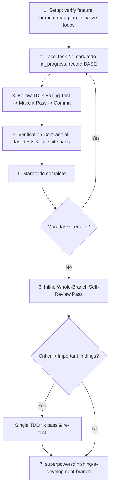

# Executing Plans (Claude Code Inline Execution)

Execute the plan yourself, task by task, in the current session: 100% single-session execution, no subagents. An inline self-review of the whole branch is performed at the end before completion.

**Why inline:** Inline execution runs in one continuous session context (yours). It eliminates the latency, cost, and context fragmentation of subagent dispatches while maintaining engineering rigor through strict Test-Driven Development (TDD).

**Model & Effort recommendation:** Execute plans with `model: sonnet` and `effort: medium`. You can trigger this automatically with the slash command `/executing-plans` (or `/duwscanspower:executing-plans`).

**Core principle:** Follow the plan step-by-step. Prove each task with a test you watched fail and then pass (TDD), commit each task cleanly, and conduct an inline whole-branch self-review before finishing.

**Continuous execution:** Do not pause to ask "should I continue?" between tasks. Execute the plan to completion unless blocked by:
1. An irreversible or destructive operation.
2. A security-sensitive action.
3. A push/merge to a remote shared branch.
4. A plan defect where every path forward is a guess.

---

## When to Use

- You have an approved plan from Claude Code native Plan mode (stored at `docs/plans/YYYY-MM-DD-<feature-name>.md`).
- You are ready to implement the tasks.

---

## The Process



---

## Setup

1. Ensure work happens on a feature branch (`git branch --show-current`). Never implement directly on `main` without explicit consent.
2. Read the plan once, note its context and Global Constraints.
3. Create todos for all tasks in the plan.
4. Load `superpowers:test-driven-development`.

---

## The Task Loop

### 1. Take the Task
- Read the task description directly from the plan.
- Record the BASE commit before starting: `git rev-parse HEAD`.
- Mark the task's todo as `in_progress`.

### 2. Work the Steps (Strict TDD)
Follow `superpowers:test-driven-development` for each task:
1. **Write failing test first**: Create the unit/integration test covering the task requirements.
2. **Watch it fail**: Run the test command and verify it fails for the expected reason.
3. **Implement minimal code**: Write only the code necessary to satisfy the test.
4. **Watch it pass**: Re-run the test command and verify it passes.
5. **Commit**: `git commit -m "[Task N] <concise description>"`.

### 3. Verification Contract
Before marking a task complete:
* Every test specified in the task exists, ran, and passed.
* Run the project test suite once to confirm no regressions were introduced.
* If any unexpected failure occurs, diagnose using `superpowers:systematic-debugging`.
* Mark the task todo as complete and proceed immediately to the next task.

---

## Final Review (Inline Whole-Branch Self-Review)

Once all tasks in the plan are complete:
1. Determine the merge base: `git merge-base main HEAD`.
2. Inspect the complete branch diff directly:
   ```bash
   git diff $(git merge-base main HEAD)..HEAD
   ```
3. Evaluate the diff against the plan and code quality rubric from `superpowers:requesting-code-review`:
   * **Plan alignment:** Did all tasks deliver what was planned? Any unintended changes?
   * **Code hygiene & types:** Clean interfaces, error handling, no debug artifacts or dead code.
   * **Test coverage:** Did every change get tests? Do tests verify behavior, not mocks?
   * **Regression & security:** Does the entire test suite pass cleanly? Any security/permission regressions?
4. **Handle Findings**:
   * **Critical / Important**: Fix them in a single focused TDD pass (write failing test $\rightarrow$ fix $\rightarrow$ green test suite).
   * **Minor**: Present them to your human partner in your final summary as deferred items.
5. Once the final review is clean, invoke `superpowers:finishing-a-development-branch`.

---

## Example Workflow

```
You: I'm using the executing-plans skill to implement this plan inline.

[Setup: on feature branch feature/hook-system]
[Read plan: docs/plans/feature-plan.md]
[Create todos for Tasks 1-3]

--- Task 1: Hook installation script ---
[Mark Task 1 in_progress; BASE: a1b2c3d]
[Step 1: Write failing test in test/hooks.test.js]
[Step 2: npm test -- hooks -> FAIL: installHook not defined]
[Step 3: Implement installHook in src/hooks.js]
[Step 4: npm test -- hooks -> PASS (1/1 passed)]
[Step 5: git commit -m "feat: implement hook installation script"]
[Task 1 complete]

--- Task 2: Recovery modes ---
[Mark Task 2 in_progress; BASE: d4e5f6a]
[Step 1: Write failing test in test/recovery.test.js]
[Step 2: npm test -- recovery -> FAIL]
[Step 3: Implement recovery options]
[Step 4: npm test -- recovery -> PASS (8/8 passed)]
[Step 5: git commit -m "feat: add verify and repair recovery modes"]
[Task 2 complete]

--- After all tasks ---
[Run full suite: npm test -> 12/12 passed]
[Inspect branch diff: git diff $(git merge-base main HEAD)..HEAD]
[Inline Self-Review]: Spec compliance ✅. No critical issues. All tests green.
[Deferred minor noted for user: add README snippet]

Done! Using superpowers:finishing-a-development-branch.
```
