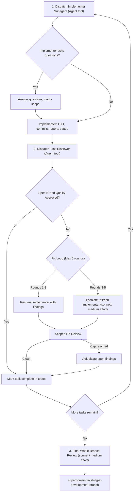

# Subagent-Driven Development (Claude Code)

Execute the implementation plan by dispatching a fresh implementer subagent per task, running a task review (spec compliance + code quality) after each, and running a broad whole-branch review at the end.

**Why subagents:** You delegate tasks to specialized agents with isolated context windows. Each subagent runs in its own context without inheriting your session's bloated history, keeping the coordinator context clean.

**Core principle:** Fresh subagent per task + task review (spec + quality) + broad final review = high quality, fast iteration.

**Continuous execution:** Do not pause to check in with your human partner between tasks unless blocked by:
1. An irreversible or destructive operation.
2. A security-sensitive action.
3. A push/merge to a remote shared branch.
4. A plan defect where every path forward is a guess.

---

## Model & Effort Selection (Token Cost Optimization)

> [!IMPORTANT]
> **Rule for Model & Effort Allocation:**
> - `model: "opus"` and `effort: "high"` are strictly reserved for the **main interactive session** (coordinator / architect).
> - **All dispatched subagents MUST use `effort: "medium"` (or `"low"` for transcription/mechanical tasks) and model `"sonnet"` (or `"haiku"` for exploration). Subagent dispatches NEVER use `opus` or `high` effort.**
> - **Always explicitly specify both `model` and `effort` in every `Agent` tool call.** An omitted model or effort silently inherits the main session's active settings (e.g. Opus with High effort), wasting significant token budget.

Evaluate each task in the Plan and assign model and effort accordingly:

| Task Complexity / Role | Indicators | Subagent Type | Model | Effort |
| :--- | :--- | :--- | :--- | :--- |
| **Research / Exploration** | Codebase lookups, grep symbols, locating files | `Explore` | `haiku` | *N/A (0)* |
| **Low Complexity Task** | 1–2 files, simple edits, boilerplate, transcription of plan code, simple unit tests | `general-purpose` | `haiku` (transcription) or `sonnet` | `low` |
| **Medium Complexity Task** | Standard business logic, module integration, standard TDD cycle, routine task review | `general-purpose` | `sonnet` | `medium` |
| **High Complexity Task** | Subtle concurrency/async, complex state machines, performance optimizations | `general-purpose` | `sonnet` | `medium` |
| **Fix Loop Escalation (Rounds 4–5)** | Implementer got stuck, repeated test failures | `general-purpose` | `sonnet` (fresh context) | `medium` |
| **Whole-Branch Final Review** | Full branch diff review, architecture, security | `general-purpose` | `sonnet` | `medium` |

---

## The Task Loop



### 1. Dispatch the Implementer

Record `BASE` (`git rev-parse HEAD`) before dispatching.

Dispatch the implementer using Claude Code's `Agent` tool:
```json
{
  "name": "Agent",
  "input": {
    "description": "Implement Task N: [task name]",
    "subagent_type": "general-purpose",
    "model": "[model chosen by task complexity]",
    "effort": "[effort chosen by task complexity]",
    "prompt": "<Full task instructions from the plan, requirements, expected tests, and acceptance criteria>"
  }
}
```

* Pass the task's requirements, expected inputs/outputs, test commands, and constraints directly in the `prompt`.
* Do not paste accumulated history of prior tasks into the prompt.
* Implementer follows TDD: write failing test $\rightarrow$ make it pass $\rightarrow$ commit.
* The implementer returns status (`DONE`, `DONE_WITH_CONCERNS`, `NEEDS_CONTEXT`, or `BLOCKED`), commit hashes, and test verification output.

### 2. Review the Task

Once the implementer finishes, record `HEAD` (`git rev-parse HEAD`).
Dispatch a task reviewer subagent via `Agent`:
```json
{
  "name": "Agent",
  "input": {
    "description": "Review Task N (spec + quality)",
    "subagent_type": "general-purpose",
    "model": "sonnet",
    "effort": "medium",
    "prompt": "<Task requirements, BASE commit, HEAD commit, instruct reviewer to run 'git diff BASE..HEAD' and review spec compliance + code quality>"
  }
}
```

* The reviewer checks:
  1. **Spec Compliance**: Did the change do what the task asked? Did it add extra unrequested features (YAGNI violation)?
  2. **Code Quality**: Test cleanliness, error handling, maintainability.
* Reviewer reports `Spec ✅ / ❌` and `Task Quality: Approved / Changes Requested`.

### 3. The Fix Loop

If findings are reported (Spec ❌ or Critical/Important issues):
* **Rounds 1–3**: Re-prompt the original implementer (or resume it) with the exact findings.
* **Rounds 4–5 (Escalation)**: If stuck after 3 rounds, dispatch a fresh implementer with a fresh context (`model: "sonnet"`, `effort: "medium"`).
* Each fix round is followed by a scoped re-review against the fix commit range.
* Maximum 5 rounds. If round 5 still has open findings, adjudicate them: rule on whether they are blocking or acceptable, and proceed.

### 4. Complete the Task & Proceed
Mark the task complete in your todo list and proceed to the next task in the plan immediately.

---

## Final Review

Once all plan tasks are complete:
1. Determine merge base: `git merge-base main HEAD`.
2. Dispatch the final whole-branch code reviewer via the `Agent` tool (`model: "sonnet"`, `effort: "medium"`):
   ```json
   {
     "name": "Agent",
     "input": {
       "description": "Final whole-branch review",
       "subagent_type": "general-purpose",
       "model": "sonnet",
       "effort": "medium",
       "prompt": "Perform comprehensive review of the entire branch diff against the plan and architectural goals."
     }
   }
   ```
3. If critical findings emerge, dispatch ONE fix subagent for the complete batch, then re-review.
4. When clean, invoke `superpowers:finishing-a-development-branch`.
